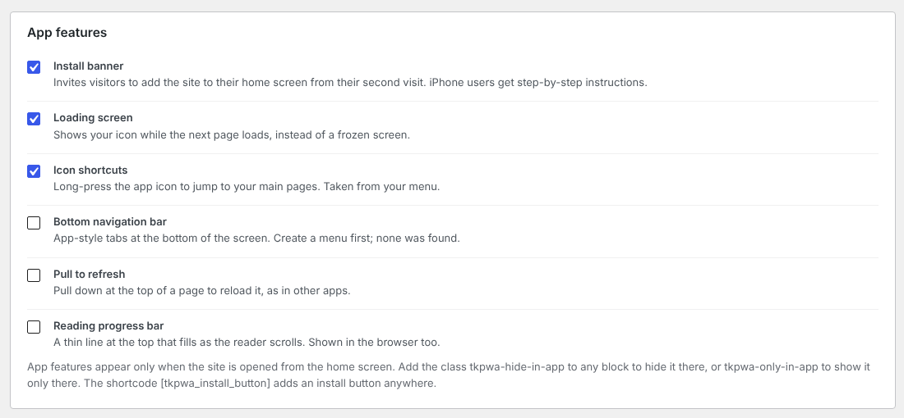

# Takumi PWA

A WordPress plugin that makes a site installable as a Progressive Web App with no setup.

On activation it reads the site title, Site Icon and theme colors and generates the web app manifest, the service worker and every icon size from them. The admin screen leads with a status checklist rather than a form, because on most sites there is nothing to fill in.



## Features

**Core**

- Web app manifest and service worker, served from the home URL with a query argument: no files in the site root, no rewrite rules, works on any permalink setting
- Icons in every size the platforms need (192/512, Android maskable, iOS 180 with no transparency) from a single image, with a drawn placeholder when there is none
- Offline reading: network-first pages with a cached fallback, stale-while-revalidate for theme and plugin assets, and an offline page that lists what can still be read
- Status checklist: HTTPS, icons, a loopback fetch of the manifest and worker, and conflicting plugins

**App features** (shown only when launched from the home screen)

- Install banner, with illustrated steps for iOS Safari, and an `[tkpwa_install_button]` shortcode
- Bottom navigation bar built from the existing menu, including block-theme navigation and the page list block
- Manifest shortcuts from the same menu
- Loading screen, pull to refresh, reading progress bar
- `tkpwa-hide-in-app` / `tkpwa-only-in-app` CSS classes
- Printable install QR code on the settings screen

**Integrations**

- Offline form submissions for Contact Form 7, WPForms and Gravity Forms
- Per-language manifests for Polylang and WPML
- Web Share Target: share a link or text from Android into a new draft post
- Warning when another service-worker plugin is active

## How caching stays safe

Whether a page may be stored is decided on the server, where login state and shop pages are known, and passed to the service worker as an `X-TKPWA-Cache: bypass` response header. Logged-in views, previews and WooCommerce / Easy Digital Downloads cart, checkout and account pages carry it. The admin, login, REST API and cron endpoints are never routed through the worker at all.

The worker's URL includes a fingerprint of the settings, so saving them installs a fresh worker and retires the old caches on every device.

## Requirements

- WordPress 6.0+
- PHP 7.4+ with the GD extension
- HTTPS (browsers only register service workers on secure origins)

## Development

```
bin/deploy.sh   # copy the working tree into the local WordPress install
bin/build.sh    # build the WordPress.org zip
```

## License

GPLv2 or later. Bundles [qrcode-generator](https://github.com/kazuhikoarase/qrcode-generator) by Kazuhiko Arase (MIT).
